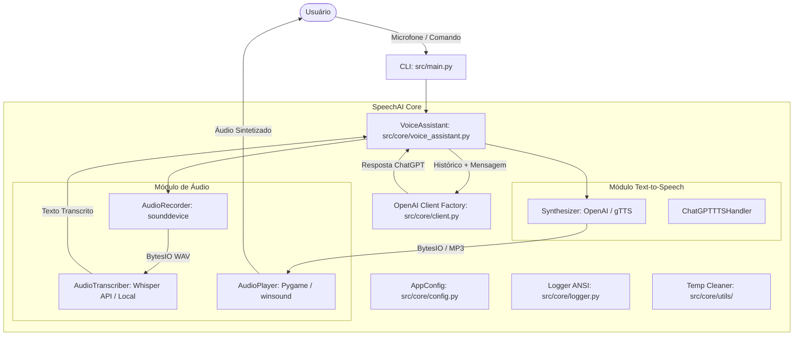

# 🎙️ SpeechAI

[](https://www.python.org/)
[](LICENSE)
[](#arquitetura-do-projeto)
[](#testes-automatizados)

**SpeechAI** é um framework em Python modular, moderno e robusto para **processamento de áudio**, **Speech-to-Text (STT)**, **Text-to-Speech (TTS)** e **Assistentes de Voz conversacionais em tempo real**.

O projeto suporta múltiplos motores de voz (OpenAI TTS e Google gTTS), transcrição de fala com OpenAI Whisper ou modelos locais (`faster-whisper`), reprodução de áudio à prova de vazamentos (Pygame e Windows native `winsound`), além de uma CLI unificada com comandos dedicados e auto-diagnóstico.

---

## 📑 Sumário

- [Visão Geral e Destaques](#-visão-geral-e-destaques)
- [Arquitetura do Projeto](#-arquitetura-do-projeto)
- [Estrutura de Diretórios](#-estrutura-de-diretórios)
- [Pré-requisitos e Instalação](#-pré-requisitos-e-instalação)
- [Configuração de Variáveis de Ambiente (.env)](#-configuração-de-variáveis-de-ambiente-env)
- [Guia da CLI (Linha de Comando)](#-guia-da-cli-linha-de-comando)
- [Uso Programático (Python API)](#-uso-programático-python-api)
- [Comparativo de Motores TTS](#-comparativo-de-motores-tts)
- [Testes Automatizados](#-testes-automatizados)
- [Diagnósticos e Resolução de Problemas](#-diagnósticos-e-resolução-de-problemas)
- [Contribuindo](#-contribuindo)
- [Licença](#-licença)

---

## 🚀 Visão Geral e Destaques

- **🎤 Assistente de Voz Conversacional Inteligente**: Loop de diálogo com captura de microfone, transcrição, raciocínio contextual via ChatGPT (`gpt-4o-mini`, `gpt-4o`, etc.) e resposta falada.
- **⚡ Múltiplos Motores TTS**:
  - **OpenAI TTS** (`tts-1`, `tts-1-hd`): vozes de altíssima fidelidade (`nova`, `alloy`, `echo`, `fable`, `onyx`, `shimmer`).
  - **Google TTS (`gTTS`)**: gratuito, sem necessidade de chave de API, suporte nativo a múltiplos idiomas e sotaques.
  - **Síntese Direta em Memória (`io.BytesIO`)**: sem latência de gravação de arquivos temporários em disco.
- **🎧 Speech-to-Text (STT) Híbrido**:
  - **OpenAI Whisper API (`whisper-1`)**: ultra rápido e preciso via nuvem.
  - **Local Whisper (`faster-whisper`)**: execução 100% offline em CPU/GPU (carregamento sob demanda lazy-loaded).
- **🔊 Player de Áudio Multi-Backend Sem Travamentos**:
  - Gerenciamento inteligente de handles no Windows (evita erros de arquivo travado `PermissionError`).
  - Fallback automático entre Pygame mixer, Windows `winsound` nativo e `playsound`.
- **🛠️ CLI Profissional Unificada**:
  - Subcomandos: `assistant`, `speak`, `transcribe`, `play`, `check`, `clean`.
  - Ferramenta embutida de verificação de ambiente (`speechai check`).
- **🛡️ Tratamento Defensivo & Zero Crashes**:
  - Nenhum script executa código de rede ou microfone acidentalmente no import.
  - Compatível com Python 3.8 até Python 3.15+.

---

## 🏗 Arquitetura do Projeto



---

## 📁 Estrutura de Diretórios

```
speechAI/
├── .env.example                     # Modelo documentado de variáveis de ambiente
├── .gitignore                       # Ignora venv, caches, logs e arquivos de áudio temporários
├── pyproject.toml                   # Padrão moderno PEP 517/621 de empacotamento
├── requirements.txt                 # Dependências modernas e validadas
├── README.md                        # Documentação completa do projeto
├── temp/                            # Diretório temporário gerenciado para gravações/áudios
├── src/
│   ├── __init__.py                  # Torna src um pacote Python importável
│   ├── main.py                      # Ponto de entrada CLI completo
│   ├── core/
│   │   ├── __init__.py              # Exporta os componentes principais
│   │   ├── config.py                # Gerenciador de configurações centralizado (.env)
│   │   ├── logger.py                # Logging formatado com cores ANSI
│   │   ├── client.py                # Provedor do cliente OpenAI com cache
│   │   ├── voice_assistant.py       # Classe VoiceAssistant e loop de conversação
│   │   ├── audio/
│   │   │   ├── __init__.py          # Facade do módulo de áudio
│   │   │   ├── audio_transcriber.py # Transcrição com Whisper (API e local lazy-load)
│   │   │   ├── player.py            # AudioPlayer multi-backend (Pygame/winsound)
│   │   │   └── recorder.py          # Gravação de microfone para BytesIO WAV
│   │   ├── tts/
│   │   │   ├── __init__.py          # Facade do módulo TTS
│   │   │   ├── synthesizer.py       # Síntese via OpenAI TTS e Google gTTS
│   │   │   ├── chatgpt_tts_handler.py # Pipeline de conversação e fala
│   │   │   ├── text_to_speech.py    # Módulo de compatibilidade retroativa
│   │   │   └── tts_core.py          # Módulo de compatibilidade retroativa
│   │   └── utils/
│   │       ├── __init__.py          # Exporta utilitários
│   │       ├── temp_file_cleaner.py # Limpeza segura de arquivos com validações
│   │       └── clean_folder.py      # Alias de compatibilidade retroativa
│   ├── audio_playback/
│   │   ├── __init__.py
│   │   ├── play_audio_playsound.py  # Script CLI seguro para playsound
│   │   └── play_audio_pygame.py     # Script CLI seguro para pygame
│   ├── realtime_processing/
│   │   ├── __init__.py
│   │   ├── realtime_gtts.py         # Fala em tempo real com gTTS e benchmark
│   │   ├── realtime_openai.py       # Fala em tempo real com OpenAI TTS e benchmark
│   │   └── speech_to_text_realtime.py # Transcrição contínua em streaming
│   └── text_to_speech/
│       ├── __init__.py
│       ├── text_to_speech_gtts.py   # Utilitário para salvar áudios com gTTS
│       ├── text_to_speech_openai.py # Utilitário para salvar áudios com OpenAI
│       └── text_to_speech_openai_realtime.py # Utilitário de fala em tempo real
└── tests/                           # Suíte de testes automatizados (unittest)
    ├── __init__.py
    ├── test_config.py               # Testes de configurações e .env
    ├── test_cleaner.py              # Testes do utilitário de limpeza de arquivos
    ├── test_player.py               # Testes do reprodutor e fallbacks
    ├── test_tts.py                  # Testes dos sintetizadores OpenAI e gTTS
    ├── test_transcriber.py          # Testes de transcrição Whisper
    └── test_voice_assistant.py      # Testes do loop conversacional e comandos de saída
```

---

## 💻 Pré-requisitos e Instalação

### 1. Pré-requisitos
- **Python 3.8+** (testado e homologado até Python 3.15).
- Microfone e alto-falantes/fones de ouvido configurados no sistema operacional.

### 2. Clonar o repositório
```bash
git clone https://github.com/seu-usuario/speechAI.git
cd speechAI
```

### 3. Criar e ativar o ambiente virtual (recomendado)
No **Windows (PowerShell)**:
```powershell
python -m venv .venv
.\.venv\Scripts\Activate.ps1
```

No **Linux / macOS**:
```bash
python3 -m venv .venv
source .venv/bin/activate
```

### 4. Instalar as dependências
```bash
pip install -r requirements.txt
```

> **Dica**: Caso deseje suporte a transcrição offline local via `faster-whisper`:
> ```bash
> pip install faster-whisper
> ```

---

## ⚙️ Configuração de Variáveis de Ambiente (.env)

Copie o arquivo de exemplo para criar seu `.env`:

```bash
cp .env.example .env
```

Abra o arquivo `.env` e configure suas preferências:

```ini
# Chave da OpenAI (obrigatória para modelos ChatGPT, OpenAI TTS e Whisper API)
OPENAI_API_KEY=sk-proj-sua-chave-aqui

# URL Base Customizada (opcional: para Ollama, LocalAI, OpenRouter, Groq, vLLM, proxies)
# Variáveis aceitas: OPENAI_BASE_URL, BASE_URL ou OPENAI_API_BASE
OPENAI_BASE_URL=http://localhost:11434/v1

# Modelo de Chat do ChatGPT
OPENAI_CHAT_MODEL=gpt-4o-mini

# Motor de Transcrição de Fala (STT): "openai" ou "local"
STT_ENGINE=openai
OPENAI_WHISPER_MODEL=whisper-1
LOCAL_WHISPER_MODEL=tiny.en

# Motor de Síntese de Voz (TTS): "openai" ou "gtts"
TTS_ENGINE=openai
OPENAI_TTS_MODEL=tts-1
OPENAI_TTS_VOICE=nova
GTTS_LANGUAGE=pt
GTTS_TLD=com.br

# Reprodutor de Áudio: "auto", "pygame", "winsound" ou "playsound"
PLAYBACK_ENGINE=auto
AUDIO_SAMPLE_RATE=44100
AUDIO_CHANNELS=1
AUDIO_RECORD_DURATION=5.0

# Diretório temporário e nível de log
TEMP_DIR=temp
LOG_LEVEL=INFO
```

---

## 🎮 Guia da CLI (Linha de Comando)

O projeto oferece uma interface de linha de comando completa através de `src/main.py`:

### 1. Diagnóstico do Sistema
Verifique se microfones, reprodutores e chaves de API estão funcionais:
```bash
python src/main.py check
```

### 2. Iniciar o Assistente de Voz Interativo
Inicia a escuta contínua pelo microfone com respostas de áudio do assistente:
```bash
python src/main.py assistant
```
*Opções personalizadas:*
```bash
python src/main.py assistant --model gpt-4o --tts openai --stt openai
```
> Para encerrar a qualquer momento, fale: `"sair"`, `"tchau"`, `"exit"` ou pressione `Ctrl + C`.

### 3. Falar um Texto (Text-to-Speech)
Sintetiza e reproduz o texto imediatamente:
```bash
# Com gTTS (Google, gratuito e sem chave de API):
python src/main.py speak "Olá, seja muito bem-vindo ao SpeechAI!" --engine gtts

# Com OpenAI TTS:
python src/main.py speak "Hello, I am your intelligent speech assistant." --engine openai --voice nova

# Apenas salvar em arquivo sem reproduzir:
python src/main.py speak "Texto para áudio" --engine gtts --save temp/audio.mp3 --no-play
```

### 4. Transcrever Áudio (Speech-to-Text)
Transcreva um arquivo de áudio existente ou grave diretamente do microfone:
```bash
# Gravar 5 segundos do microfone e transcrever:
python src/main.py transcribe --record 5

# Transcrever um arquivo de áudio existente:
python src/main.py transcribe temp/audio.mp3
```

### 5. Reproduzir um Arquivo de Áudio
Reproduz arquivos WAV, MP3 ou OGG com liberação garantida dos descritores de arquivo:
```bash
python src/main.py play temp/audio.mp3
```

### 6. Limpar Arquivos Temporários
Remove com segurança todos os arquivos gerados em `temp/`:
```bash
python src/main.py clean
```

---

## 🐍 Uso Programático (Python API)

Você pode importar e utilizar o SpeechAI dentro de qualquer script ou aplicação Python:

### Síntese de Voz (TTS)
```python
from src.core.tts import synthesize_text, synthesize_to_bytes
from src.core.audio import play_audio

# 1. Síntese direta em arquivo (escolha 'openai' ou 'gtts')
audio_file = synthesize_text("Olá mundo!", output_file="temp/ola.mp3", engine="gtts")
play_audio(audio_file)

# 2. Síntese em memória (zero disco, menor latência)
audio_buffer = synthesize_to_bytes("Reproduzindo diretamente da memória RAM.", engine="gtts")
play_audio(audio_buffer)
```

### Gravação e Transcrição (STT)
```python
from src.core.audio import record_audio_to_bytes, transcribe_audio

# Grava 3 segundos do microfone diretamente para buffer WAV em memória
wav_buffer = record_audio_to_bytes(duration=3.0)

# Transcreve usando o Whisper
texto = transcribe_audio(wav_buffer, engine="openai")
print(f"Você disse: {texto}")
```

### Instanciando um Assistente de Voz Personalizado
```python
from src.core.voice_assistant import VoiceAssistant

assistente = VoiceAssistant(
    system_prompt="Você é um professor particular de inglês focado em pronúncia.",
    chat_model="gpt-4o-mini",
    tts_engine="openai",
)

# Faz uma pergunta e recebe a resposta falada
resposta = assistente.chat_and_speak("How can I improve my English pronunciation?")
print(resposta)
```

---

## 📊 Comparativo de Motores TTS

| Recurso | OpenAI TTS (`tts-1` / `tts-1-hd`) | Google TTS (`gTTS`) |
| :--- | :--- | :--- |
| **Qualidade da Voz** | Ultra natural, tom humano expressivo | Robótica / padrão assistente |
| **Necessita Chave de API** | Sim (`OPENAI_API_KEY`) | Não (Gratuito) |
| **Vozes Disponíveis** | 6 vozes (`nova`, `alloy`, `echo`, `fable`, `onyx`, `shimmer`) | Varia por idioma/país |
| **Suporte a Idiomas** | Múltiplos idiomas | Extenso (+100 idiomas) |
| **Velocidade de Geração** | Rápida via API | Muito rápida |
| **Custo** | Pago por caractere sintetizado | Gratuito |
| **Execução em Memória** | Sim (`io.BytesIO`) | Sim (`io.BytesIO`) |

---

## 🧪 Testes Automatizados

O projeto inclui uma suíte completa de testes unitários que não requer conexões externas (mocks completos de APIs de rede):

Para executar todos os testes:
```bash
python -m unittest discover tests
```

Saída esperada:
```
Ran 21 tests in 1.003s

OK
```

---

## 🔧 Diagnósticos e Resolução de Problemas

Execute sempre a ferramenta de diagnóstico para identificar inconsistências no ambiente:
```bash
python src/main.py check
```

### Problemas Frequentes:

1. **`OPENAI_API_KEY is not configured`**:
   - Certifique-se de ter criado o arquivo `.env` na raiz do projeto com sua chave válida da OpenAI.
   - Alternativamente, use o motor gratuito `gtts` passando `--engine gtts` ou alterando `TTS_ENGINE=gtts` no `.env`.

2. **Microfone não detectado (`sounddevice`)**:
   - No Windows: Verifique as Configurações de Privacidade do Windows -> Permissões de Aplicativo -> Microfone -> "Permitir que os aplicativos da área de trabalho acessem o microfone".

3. **Erro de compilação do `pygame` no Windows**:
   - Utilize a versão moderna comunitária `pygame-ce` (já configurada no `requirements.txt`), que disponibiliza rodas pré-compiladas binárias inclusive para versões recentes do Python.

4. **Arquivos temporários bloqueados no Windows**:
   - O `AudioPlayer` implementado no SpeechAI invoca automaticamente `pygame.mixer.music.unload()` e `stop()` após a execução para garantir a liberação do arquivo no Windows File System.

---

## 🤝 Contribuindo

Contribuições são muito bem-vindas! Siga os passos:

1. Faça um Fork do projeto
2. Crie uma branch para a sua feature (`git checkout -b feature/minha-melhoria`)
3. Adicione testes para o novo recurso em `tests/`
4. Garanta que todos os testes passem (`python -m unittest discover tests`)
5. Faça o commit (`git commit -m 'feat: adiciona novo suporte a motor de áudio'`)
6. Envie para o branch remoto (`git push origin feature/minha-melhoria`)
7. Abra um Pull Request detalhado

---

## 📜 Licença

Distribuído sob a licença MIT. Consulte o arquivo [LICENSE](LICENSE) para obter mais informações.
